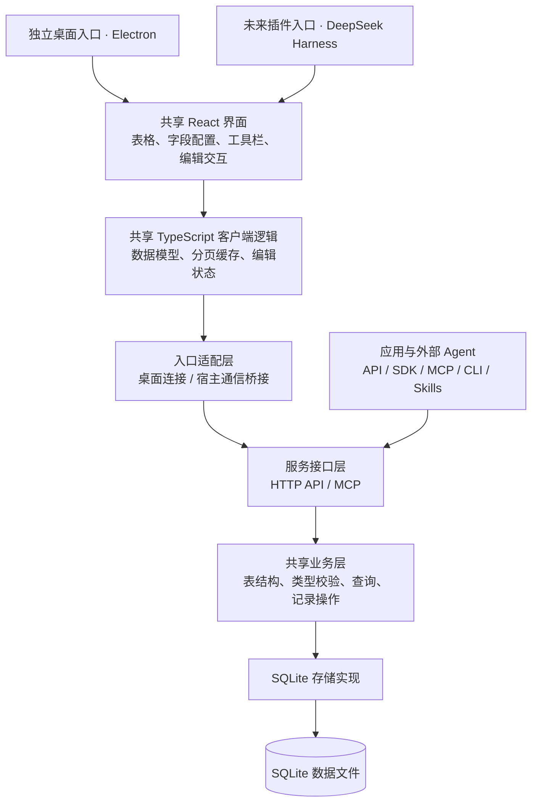

# RowWeave

RowWeave 是一个面向业务团队的开源结构化表格存储服务，支持自定义表结构，提供供人使用的桌面客户端，以及供应用和 AI Agent 使用的接口。

项目以 TypeScript 为主要开发语言，优先支持单机部署。先交付独立桌面客户端，未来通过 DeepSeek Harness 插件复用界面和客户端逻辑。

> 当前处于设计与原型准备阶段。本 README 记录设计方向与验证计划，所述产品能力尚未实现；仓库暂不提供可运行的应用或安装命令。

## 命名

- 文档、界面和品牌名称：**RowWeave**。
- 仓库、包名和命令：`rowweave`。

## 产品定位

RowWeave 面向使用多维表格管理业务的团队。用户可以定义字段和记录，通过表格界面维护数据，也可以让外部应用或 Agent 操作同一份数据。

产品以多维表格的数据模型为基础，首版不追求 Excel 式任意单元格计算，也不绑定客户管理、项目管理等特定业务流程。

这里的 AI native 指核心能力适合被 Agent 理解和调用：

- HTTP API 与 TypeScript SDK 提供明确的数据契约。
- MCP 为 Agent 提供结构发现、查询和数据操作能力。
- CLI 支持可组合的命令和机器可读输出。
- Skills 说明如何完成任务、检查结果以及处理操作失败。

AI 推理、上下文组织、任务编排和恢复由外部 Agent 承担。RowWeave 专注于结构化数据及其可靠操作，首版不内置聊天助手、模型调用或 AI 任务平台。

## 设计原则

1. **先做独立客户端，再做宿主插件。** DeepSeek Harness 是未来的接入入口，当前原型不依赖其运行时。
2. **界面与宿主解耦。** 桌面客户端和未来插件复用 React 组件及客户端逻辑，各自保留薄适配层。
3. **业务规则集中在服务端。** 人、程序和 Agent 使用同一套数据校验和操作语义。
4. **服务可以独立运行。** 数据服务不依赖 Electron 或 Harness，可以脱离桌面窗口提供 API。
5. **数据按需加载。** 大表通过服务端查询、可见区域加载和有界缓存访问，避免全量数据驻留客户端。
6. **用实测决定性能取舍。** 区分界面响应、查询耗时、启动时间和整体资源占用。

## 整体架构



图中的模块是职责边界，不代表要部署多个微服务。CLI 和 SDK 作为客户端调用服务，Skills 是随项目分发的使用指南。

### 桌面客户端

使用 **Electron + React + TypeScript**。表格优先评估 **Glide Data Grid**，在原型验证通过后确定正式采用。

Electron 负责窗口和必要的系统集成。React 界面负责表格、字段配置和编辑交互。独立服务进程负责查询和写入，避免数据库操作阻塞渲染进程或 Electron 主进程。

选择 Electron 的主要原因是与 TypeScript/Node.js 技术栈匹配、浏览器引擎版本可控，以及桌面交付路径成熟。其运行时体积和基础资源开销需要实测；使用原生 SQLite 驱动时，也需要验证 Electron ABI、平台架构和安装包兼容性。

### 代码复用边界

| 模块 | 职责与复用方式 |
| --- | --- |
| 共享界面 | 表格、选区、单元格编辑、字段配置和工具栏；不直接调用 Electron 或 Harness API |
| 共享客户端逻辑 | 类型、查询状态、分页缓存和编辑状态；按实例创建，支持多个表格面板 |
| 宿主适配层 | 服务连接、宿主通信、文件选择、主题和生命周期管理 |
| 业务核心 | 数据校验和操作规则；不导入 Electron、Harness 或前端组件 |
| 存储实现 | SQLite 查询、事务和迁移；由服务统一访问 |

共享界面通过明确的数据接口和回调调用能力。样式限定在 RowWeave 容器内，主题可覆盖，弹窗和编辑浮层支持指定挂载容器。

未来 Harness 插件负责注册界面入口、适配宿主通信和管理组件生命周期。它不复制一套业务逻辑，也不直接打开 SQLite 文件。

### 服务与部署

服务端使用 **TypeScript + Node.js + SQLite**，优先提供 HTTP + JSON 接口。HTTP 框架、SQLite 驱动和桌面打包工具在原型阶段按兼容性确定。

支持的部署方向：

- **本机使用：** 桌面端启动随应用交付的数据服务，连接本机接口。
- **团队使用：** 一台机器独立运行数据服务，多个客户端连接同一服务。

单机部署不等于单用户，也不等于每个客户端持有一份数据库。离线多副本同步不在首版范围内。

桌面应用关闭时，仅管理自己启动的服务实例；独立部署的团队服务有自己的生命周期。

## 数据与操作模型

基础对象包括：

- **Table：** 一张表及其字段定义。
- **Field：** 具有稳定 ID、名称和类型的字段。
- **Record：** 具有稳定 ID 的记录，其字段值由字段 ID 标识。

表、字段和记录的身份与展示名称、行列位置分离。修改字段名称或调整排序，不应改变对象身份。

服务核心逐步提供：

- 表和字段定义。
- 记录增删改查与类型校验。
- 字段选择、筛选、排序和稳定分页。
- 原子批量写入与明确的错误结果。
- 写入版本检查，避免并发修改时静默覆盖。

原型先使用固定 Schema 和文本字段。后续再扩展基础字段类型及动态结构管理。

**动态字段在 SQLite 中的物理存储方案尚未确定。** 真实表列、JSON 或混合方案需要结合字段变更、查询和索引测试选择。字段改类型时，必须明确已有数据的转换、失败和回滚语义。

## 首个原型

原型目标是验证独立桌面客户端、表格组件和持久化服务能否形成可靠、流畅的操作闭环。

### 范围

- 一个 Electron 主窗口和一张固定结构的测试表。
- 获取字段信息、记录总数和分页数据。
- 单元格选择、键盘导航、矩形选区和文本编辑。
- 中文输入法、复制粘贴及批量保存。
- SQLite 持久化，重启服务后能读取已保存的结果。
- 按需加载、虚拟化和有界缓存。
- 明确的加载、保存和失败反馈。

原型暂不实现完整 MCP、CLI、Harness 插件、通用动态 Schema 引擎或完整产品设置。

### 验证方式

准备确定性的测试数据，先验证小表，再扩展到以下规模：

- 1 万行 × 20 列。
- 10 万行 × 100 列。

这些规模用于压力测试，不代表性能承诺。数据包含中文、emoji、空值和适量长文本，并分批生成和写入。

重点检查：

- 输入法组词确认与单元格提交互不干扰。
- 连续编辑、取消编辑、导航和选区行为一致。
- 跨表格应用复制粘贴，以及至少一次 1000 行 × 10 列的批量粘贴。
- 批量更新失败时保持原子性，界面不会将失败显示为成功。
- 保存、重新读取和服务重启后的数据一致性。
- 长时间滚动后缓存和内存仍有边界。

性能测量使用生产构建，记录硬件、操作系统、分辨率、缩放、版本和数据规模。分别测量启动、首屏、滚动帧时间、输入响应、批量保存耗时，以及包含服务进程在内的整体资源占用。

原型以目标机器上流畅的 60Hz 交互为初始方向。实测结果、推断和未验证项必须分开记录。

## 后续路线

1. **独立客户端原型：** 跑通读取、编辑、保存闭环，验证交互、性能和真实安装包。
2. **基础表格服务：** 确定动态存储方案，增加建表、字段配置、基础类型、筛选排序和 CSV 导入导出。
3. **程序与 Agent 接口：** 在共享业务能力上完善 SDK、MCP、CLI 和配套 Skills。
4. **Harness 插件：** 复用共享界面和客户端逻辑，补充宿主适配并验证集成。

首版不纳入产品内 AI、复杂自动化、公式引擎、多租户、细粒度行列权限、实时协作系统、CRDT、离线同步、仪表盘或大量视图类型。后续根据实际使用需求确定优先级。

## 拟议代码组织

以下为目标结构，目录尚未创建；原型阶段仅增加实际需要的模块。

```text
rowweave/
├── apps/
│   ├── desktop/          # Electron 桌面入口
│   └── server/           # 可独立启动的数据服务
├── packages/
│   ├── ui/               # 共享 React 界面
│   ├── client/           # HTTP 客户端、缓存和客户端模型
│   ├── contracts/        # 接口 Schema 与共享类型
│   ├── core/             # 数据结构与业务规则
│   └── storage-sqlite/   # SQLite 存储与迁移
├── integrations/
│   └── harness/          # 后续增加的 Harness 插件适配
├── skills/               # 后续增加的 Agent 使用指南
└── README.md
```

## 待验证与决定

- 首发操作系统及需要支持的平台范围。
- Glide Data Grid 的中文编辑、选区、粘贴和性能表现。
- 动态字段存储、索引和结构迁移方案。
- SQLite 驱动与 Electron 打包兼容性。
- 实际可接受的启动时间、安装体积和内存预算。
- 团队部署所需的最小认证与访问控制。
- 开源许可证；正式发布前选择并添加 `LICENSE`。

## 技术参考

- [Electron 进程模型](https://www.electronjs.org/docs/latest/tutorial/process-model)
- [Electron Utility Process](https://www.electronjs.org/docs/latest/api/utility-process)
- [Electron 原生 Node 模块](https://www.electronjs.org/docs/latest/tutorial/using-native-node-modules)
- [Glide Data Grid](https://github.com/glideapps/glide-data-grid)
- [SQLite](https://www.sqlite.org/)
- [DeepSeek Harness](https://github.com/deepseek-ai/deepseek-harness)
- [Harness React Slots](https://github.com/deepseek-ai/deepseek-harness/blob/master/docs/subsystems/slots.md)
