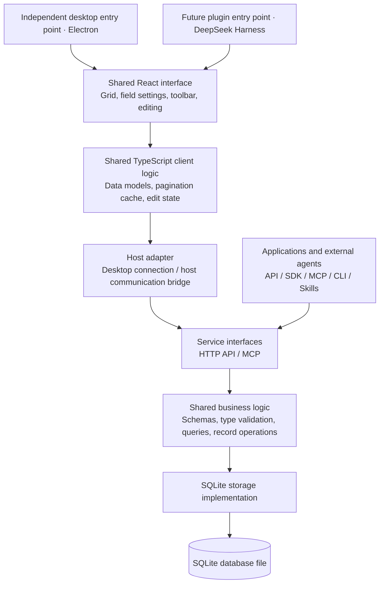

# RowWeave Design

[Product overview](../README.md) · [简体中文产品介绍](../README.zh-CN.md)

This document records the target architecture, scope, and validation plan for RowWeave. The prototype is being implemented incrementally; see [development instructions](development.md) for the components and commands currently available. This document includes future work as well as prototype scope.

## Product direction

RowWeave is an open-source structured table storage project for business teams. The intended product supports custom table schemas, a desktop client for people, and interfaces for applications and AI agents.

TypeScript is the primary implementation language, and deployment on a single machine is the initial priority. Deliver an independent desktop client first, then reuse its interface and client logic through a future DeepSeek Harness plugin.

The data model is based on structured tables with typed fields and records. The initial release does not aim to provide arbitrary Excel-style cell calculations or encode specific workflows such as customer or project management.

Here, AI native means that agents can understand and invoke the core capabilities:

- HTTP APIs and a TypeScript SDK provide explicit data contracts.
- MCP provides schema discovery, querying, and data operations for agents.
- A CLI supports composable commands and machine-readable output.
- Skills explain how to complete tasks, verify results, and handle failures.

External agents handle AI inference, context management, task orchestration, and recovery. RowWeave focuses on structured data and reliable operations. The initial release does not include a chat assistant, model calls, or an AI task platform.

## Naming

- Use **RowWeave** in documentation, the interface, and branding.
- Use `rowweave` for the repository, packages, and commands.

## Design principles

1. **Build the independent client before the host plugin.** DeepSeek Harness is a future entry point; the current prototype must not depend on its runtime.
2. **Separate the interface from its host.** The desktop client and future plugin share React components and client logic, with a thin adapter for each host.
3. **Keep business rules in the service.** People, programs, and agents use the same validation and operation semantics.
4. **Allow the service to run independently.** The data service does not depend on Electron or Harness and can provide an API without a desktop window.
5. **Load data on demand.** Access large tables through server queries, visible-region loading, and bounded caches instead of retaining the entire dataset in the client.
6. **Use measurements to guide performance tradeoffs.** Measure interface responsiveness, query latency, startup time, and total resource usage separately.

## Architecture



The modules describe responsibility boundaries, not a requirement to deploy multiple microservices. The CLI and SDK call the service as clients. Skills are usage guides distributed with the project.

### Desktop client

Use **Electron + React + TypeScript**. Evaluate **Glide Data Grid** first and confirm its adoption only after prototype validation.

Electron owns the window and necessary system integration. The React interface owns the grid, field settings, and editing interactions. A separate service process handles queries and writes so database operations do not block the renderer or Electron's main process.

Electron fits the TypeScript/Node.js stack, provides a controlled browser engine version, and has an established desktop delivery path. Its runtime size and baseline resource usage still need measurement. Native SQLite drivers also require validation of Electron ABI compatibility, platform architectures, and packaged applications.

### Code reuse boundaries

| Module | Responsibilities and reuse |
| --- | --- |
| Shared interface | Grid, selection, cell editing, field settings, and toolbar; no direct Electron or Harness API calls |
| Shared client logic | Types, query state, pagination cache, and edit state; created per instance to support multiple grid panels |
| Host adapter | Service connections, host communication, file selection, themes, and lifecycle management |
| Business core | Data validation and operation rules; no imports from Electron, Harness, or frontend components |
| Storage implementation | SQLite queries, transactions, and migrations; accessed through the service |

The shared interface accesses capabilities through explicit data interfaces and callbacks. Styles are scoped to a RowWeave container, themes can be overridden, and dialogs and editing overlays support a configurable mount container.

The future Harness plugin registers the interface entry point, adapts host communication, and manages component lifecycles. It does not duplicate business logic or open SQLite files directly.

### Service and deployment

Use **TypeScript + Node.js + SQLite**, initially exposing HTTP + JSON interfaces. Select the HTTP framework, SQLite driver, and desktop packaging tools during prototyping based on compatibility.

Planned deployment options:

- **Local use:** The desktop app starts the bundled data service and connects to its local interface.
- **Team use:** One machine runs the data service independently, and multiple clients connect to it.

Deployment on a single machine does not imply a single user or a separate database for every client. Offline synchronization between replicas is outside the initial scope.

When the desktop app closes, it manages only service instances that it started. An independently deployed team service has its own lifecycle.

## Data and operation model

The basic objects are:

- **Table:** A table and its field definitions.
- **Field:** A field with a stable ID, name, and type.
- **Record:** A record with a stable ID whose values are keyed by field ID.

Table, field, and record identities are separate from display names and row or column positions. Renaming a field or changing sort order must not change object identity.

The service core will progressively provide:

- Table and field definitions.
- Record creation, reading, updating, deletion, and type validation.
- Field selection, filtering, sorting, and stable pagination.
- Atomic batch writes and explicit error results.
- Write version checks to prevent silent overwrites during concurrent edits.

The prototype starts with a fixed schema and text fields. Basic field types and dynamic schema management come later.

**The physical storage model for dynamic fields in SQLite is undecided.** Evaluate physical table columns, JSON, and hybrid approaches against field changes, queries, and indexing. Field type changes must define how existing data is converted and how failures and rollbacks behave.

## First prototype

The prototype should establish whether the independent desktop client, grid component, and persistence service can deliver a reliable and responsive read-edit-save workflow.

### Scope

- One Electron main window and one test table with a fixed schema.
- Field metadata, total record count, and paginated data retrieval.
- Cell selection, keyboard navigation, rectangular selections, and text editing.
- Chinese input methods, copy and paste, and batch saves.
- SQLite persistence, with saved data readable after a service restart.
- On-demand loading, virtualization, and bounded caches.
- Clear loading, saving, and failure feedback.

The prototype does not include complete MCP or CLI implementations, a Harness plugin, a general dynamic schema engine, or a full set of product settings.

### Validation

Prepare deterministic test data. Start with small tables, then expand to:

- 10,000 rows × 20 columns.
- 100,000 rows × 100 columns.

These sizes are pressure-test targets, not performance promises. Include Chinese text, emoji, null values, and a moderate amount of long text. Generate incrementally and write without retaining the full dataset in memory. The prototype uses prepared inserts in one transaction to keep initialization atomic.

Verify that:

- Confirming an input method composition and committing a cell do not interfere with each other.
- Consecutive edits, edit cancellation, navigation, and selection behave consistently.
- Copying and pasting works across table applications, including at least one batch paste of 1,000 rows × 10 columns.
- Failed batch updates remain atomic, and the interface does not report a failed operation as successful.
- Data remains consistent after saving, reading it again, and restarting the service.
- Cache size and memory usage remain bounded during prolonged scrolling.

Measure performance with production builds. Record the hardware, operating system, resolution, display scaling, dependency versions, and data scale. Measure startup, first table render, scrolling frame times, input response, batch save latency, and total resource usage including the service process separately.

The initial target is smooth interaction at 60 Hz on the target machine. Report measured results, inferences, and unverified items separately.

## Roadmap

1. **Independent client prototype:** Complete the read-edit-save workflow and validate interactions, performance, and real installation packages.
2. **Basic table service:** Choose the dynamic storage model; add table creation, field configuration, basic types, filtering, sorting, and CSV import and export.
3. **Interfaces for programs and agents:** Build out the SDK, MCP, CLI, and accompanying Skills on top of shared business capabilities.
4. **Harness plugin:** Reuse the shared interface and client logic, add the host adapter, and validate the integration.

The initial release excludes in-product AI, complex automation, a formula engine, multitenancy, fine-grained row and column permissions, a real-time collaboration system, CRDTs, offline synchronization, dashboards, and a large range of view types. Prioritize later work based on actual usage needs.

## Proposed repository layout

This is the target structure. The independent prototype implements the desktop, service, and shared packages; integrations and other future modules should be added only when needed.

```text
rowweave/
├── apps/
│   ├── desktop/          # Electron desktop entry point
│   └── server/           # Independently runnable data service
├── packages/
│   ├── ui/               # Shared React interface
│   ├── client/           # HTTP client, cache, and client models
│   ├── contracts/        # API schemas and shared types
│   ├── core/             # Data structures and business rules
│   └── storage-sqlite/   # SQLite storage and migrations
├── integrations/
│   └── harness/          # Future Harness plugin adapter
├── skills/               # Future agent usage guides
├── docs/
│   └── design.md         # Architecture and prototype validation plan
├── AGENTS.md             # Contribution guidelines
├── README.md             # English product overview
└── README.zh-CN.md       # Simplified Chinese product overview
```

## Open decisions and validation work

- Initial operating system and supported platform scope.
- Glide Data Grid behavior for Chinese editing, selection, pasting, and performance.
- Dynamic field storage, indexing, and schema migration strategy.
- SQLite driver compatibility with Electron packaging.
- Acceptable startup time, installation size, and memory budgets.
- Minimum authentication and access control for team deployment.
- Open-source license; choose one and add `LICENSE` before a formal release.

## Technical references

- [Electron process model](https://www.electronjs.org/docs/latest/tutorial/process-model)
- [Electron utility process](https://www.electronjs.org/docs/latest/api/utility-process)
- [Electron native Node modules](https://www.electronjs.org/docs/latest/tutorial/using-native-node-modules)
- [Glide Data Grid](https://github.com/glideapps/glide-data-grid)
- [SQLite](https://www.sqlite.org/)
- [DeepSeek Harness](https://github.com/deepseek-ai/deepseek-harness)
- [Harness React Slots](https://github.com/deepseek-ai/deepseek-harness/blob/master/docs/subsystems/slots.md)
